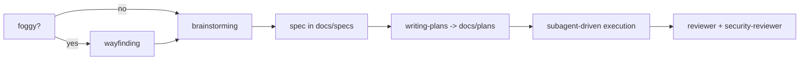

# omp-config

My [omp](https://github.com/can1357/oh-my-pi) user config. This repo is `~/.omp`, the live agent directory; no symlink layer.

`~/.omp` also holds credentials, transcripts, blobs, and caches. `.gitignore` denies everything by default and explicitly whitelists config paths, so new files stay untracked until added.

- [Why this instead of raw Claude Code](#why-this-instead-of-raw-claude-code)
- [Install](#install)
- [Providers](#providers)
- [Model roles](#model-roles)
- [Subagents](#subagents)
- [What is turned off, and why](#what-is-turned-off-and-why)
- [Skills](#skills)
- [Daily use](#daily-use)
- [What is tracked](#what-is-tracked)
- [License and attribution](#license-and-attribution)
- [Notes](#notes)

## Why this instead of raw Claude Code

This config separates provider, model role, and fallback routing. The choices that distinguish this setup:

| Concern | This config |
|---|---|
| Model per job | `modelRoles` pins named roles to provider/model/thinking-level; e.g. `default` uses Opus, `task` uses GLM Flash, and `critic` uses GPT-6.1 Terra. |
| Subagent routing | `task.agentModelOverrides` points `scout`, `reviewer`, `security-reviewer` and `task` at named roles, so their models are set in one place. |
| Provider failure | `retry.fallbackChains` supplies ordered alternatives; usage-aware fallback can avoid a provider when its remaining plan allowance is insufficient. |
| Bulk vs. review | `task` and `scout` use plan-backed GLM routes; `reviewer` uses a separate OpenAI model family from the main Claude model. |

## Install

### 1. omp

```sh
curl -fsSL https://omp.sh/install | sh     # macOS / Linux
brew install can1357/tap/omp               # Homebrew
bun install -g @oh-my-pi/pi-coding-agent   # Bun (bun >= 1.3.14)
```

Windows: `irm https://omp.sh/install.ps1 | iex`. To pin a version, use `mise use -g github:can1357/oh-my-pi`.

### 2. This config

```sh
mkdir -p ~/.omp
cd ~/.omp
git init
git remote add origin ssh://git@github.com/ismaelga/omp-config.git
git fetch origin
git checkout -f main
```

The default-deny ignore rules keep local state out of the checkout. Restart omp after updating config: settings and skills load at session start. Install and log in to the [service CLIs](#service-clis); provider logins are per provider via `/login`.

## Providers

`modelProviderOrder` controls unqualified model selectors: `zai → anthropic → ollama-cloud → opencode-go → openrouter`. Provider-qualified pins bypass that order. `openai-codex`, `typesafe` and `web` are used by explicit role pins but are not in the order.

| Provider | Authentication | Use |
|---|---|---|
| `zai` | Stored API key | Seven roles use GLM-5.3-Flash, including `task`. |
| `anthropic` | OAuth | `default`, `plan`, `slow`; account policies select the configured seats. |
| `ollama-cloud` | Stored API key | Fallback models; concurrency is capped at 8. |
| `opencode-go` | Stored API key | `sentinel` and fallback models. |
| `openrouter` | Stored API key | Explicit fallback destinations; no role pin. |
| `openai-codex` | ChatGPT OAuth | `critic` and fallback models. |
| `typesafe` | `TYPESAFE_API_KEY` | `judge`. |
| `web` | Built-in routing | `web` role. |

## Model roles

`modelRoles` maps intent to a provider-qualified model and optional thinking level. Change the role pin here rather than duplicating model IDs in agent overrides.

| Role | Model | Why |
|---|---|---|
| `default` | `anthropic/claude-opus-5-5:xhigh` | Main interactive turns and implementation. |
| `plan` | `anthropic/claude-opus-5-5:high` | Planning with strong reasoning at lower effort than the default. |
| `slow` | `anthropic/claude-opus-5-5:high` | Deliberate reasoning on demand. |
| `task` | `zai/glm-5.3-flash:high` | Subagent work on the configured flat/credit plan, with fallback chain. |
| `scout` | `zai/glm-5.3-flash:high` | Fast, concise code location and read-only investigation. |
| `critic` | `openai-codex/gpt-6.1-terra:high` | Independent-family code review. |
| `sentinel` | `anthropic/claude-sonnet-5-5:xhigh` | Security review with a separate model family. |
| `smol` | `zai/glm-5.3-flash:high` | Low-cost fan-out. |
| `tiny` | `zai/glm-5.3-flash:low` | Frequent, disposable short-form tasks. |
| `vision` | `zai/glm-5.3-flash:high` | Image understanding. |
| `commit` | `zai/glm-5.3-flash:low` | Small commit-message payloads. |
| `advisor` | `zai/glm-5.3-flash:high` | Live advisor; see [what is turned off](#what-is-turned-off-and-why). |
| `judge` | `typesafe/jev-1.14.0` | Typed model judgments. |
| `web` | `web/public` | Web search through omp's public web route. |

Model specs are `provider/model[:thinking]`, where thinking is `minimal`, `low`, `medium`, `high`, `xhigh` or `max`.

`retry.fallbackChains` resolve by specificity: exact `provider/model`, then `provider/*`, then role, then `default`; destinations are tried in order. A role-keyed chain is dead whenever a wildcard already matches that role's model. `usageAwareFallback: true` with `usageReservePct: 10` leaves a credit-metered provider before its limit rather than after a 429.

## Subagents

Four bundled agents are enabled: `scout`, `reviewer`, `security-reviewer` and `task`. `task.agentModelOverrides` routes them through named roles, keeping model selection in [Model roles](#model-roles):

| Agent | Override |
|---|---|
| `scout` | `@scout` |
| `reviewer` | `@critic` |
| `security-reviewer` | `@sentinel` |
| `task` | `@task` |

`task.eager: preferred` adds delegation guidance to the prompt without forcing a spawn; `enableLsp: true` lets agents verify callsite claims instead of guessing. `task.isolation.enabled: true` makes worktree isolation available per item (`isolated: true`); it is not the default.

## What is turned off, and why

`task.disabledAgents` disables 16 bundled agents: `sonic`, `momus` and 14 cavecrew agents. An A/B benchmark (2026-08-13, `~/.omp/bench/`) found minimal guidance matched or beat the fleet on all six tasks at about a third of the turns and tokens, and the fleet never activated on its own; the definitions stay in `agent/agents/` for re-measurement. `contextPromotion.enabled: false`: overflow compacts, the documented path, instead of switching models.

The advisor is live (`advisor.enabled: true`). The A/B scored it idle because it counted spawns, not advisor calls; its notes caught real bugs. `syncBacklog: "off"` stops a lagging advisor from blocking the main turn.

### Service CLIs

The MCP catalog is empty (`agent/mcp.json`), but omp also discovers servers from other tools' configs; the first same-named definition wins. `disabledServers` therefore hides the replaced services and third-party servers found on this machine, preventing an alternate config from mounting a replaced service. Service CLIs replace those MCP integrations; Wrangler projects still use `wrangler` and its existing skill.

| Service | CLI | Install | Login | Skill |
|---|---|---|---|---|
| Linear | `linear` 3.1.0 | `GIT_CONFIG_GLOBAL=/dev/null brew install schpet/tap/linear` | `linear auth login` (API key from linear.app/settings/account/security) | `linear-cli` |
| Sentry | `sentry` 0.47.0 (`getsentry/cli`, not legacy `sentry-cli`) | `npm i -g sentry` | `sentry auth login` | `sentry-cli` |
| Cloudflare account/API resources | `cf` 1.0.0-beta.27 | `npm i -g cf@latest` | `cf auth login` (separate from Wrangler login) | `cf-cli` |
| Notion | `ntn` 0.23.26 | `npm i -g ntn` | `ntn login` | `ntn-cli` |
| Alchemy | `alchemy` 0.30.0 (`@alchemy/cli`) | `npm i -g @alchemy/cli@latest` | `alchemy auth` | `alchemy-cli` |

Why: every mounted MCP tool name lands in every session's system prompt. Before the cut (2026-11-04) Linear and Sentry alone put ~125 tool entries there, each listed three times; Alchemy's server advertised 168 when enabled. A skill costs one description line until loaded. The five CLI skills were baseline-tested: without them, agents invented commands and flags (`sentry issue view --full-stacktrace`, `linear graphql`, `cf … --yes`); with them, repeated attempts converged on valid commands checked against installed `--help`. The Alchemy skill requires explicit user instruction for signing, spending and wallet or service administration writes.

The unused `voyager` and unconnected `slack` servers were removed without replacement. The MCP keychain/bearer-header helpers are gone (design in git history before `a4b5c83`); jev-ts's MCP map is empty and `jev route` skips an empty catalog.

`agent/WATCHDOG.md` and `agent/WATCHDOG.yml` configure the live advisor. The roster grants `read`, `grep`, `glob` and `lsp`, but not `bash`, `edit` or `write`; only its first `advise` call per model turn is kept, and requesting an unavailable tool quarantines the entire turn, including advice.

## Skills

`agent/skills/` holds 85 skills: 70 written or copied here, 15 symlinks into `.sources/` submodules. 53 are model-invoked: their descriptions sit in every system prompt and omp loads a skill when one matches. 32 are command-only (`disable-model-invocation: true`): they cost nothing per turn and load only via `/skill:<name>`, which is why retiring a skill here means setting that flag rather than deleting it. List them:

```sh
grep -l '^disable-model-invocation: true' agent/skills/*/SKILL.md
```

omp also discovers skills from `~/.config/opencode/skills` (the sibling `opencode-config` checkout), so deleting a skill here does not stop a same-named copy loading from there.

- **Service CLIs** (replace MCP, see [Service CLIs](#service-clis)): `linear-cli`, `sentry-cli`, `cf-cli`, `ntn-cli`, `alchemy-cli`; `linear` is the command-only TODO.md → Linear sync.
- **Design**: `wayfinding`, `brainstorming`, `grilling`, `grill-me`, `grill-with-docs`, `prototyping`, `baseline-first`, `codebase-design`, `domain-modeling`, `to-questionnaire`, `to-spec`, `research`, `writing-plans`, `pre-mortem`, `decision-log`.
- **Execution**: `subagent-driven-development`, `dispatching-parallel-agents`, `diverge-converge`, `implement`, `to-tickets`, `triage`, `using-git-worktrees`, `resolving-merge-conflicts`, `finishing-a-development-branch`, `wizard`, `handoff`.
- **Quality**: `test-driven-development`, `systematic-debugging`, `code-review`, `interrogate`, `blast-radius`, `deslop`, `unslop`, `create-verification-skill`, `maintain-verification-skill`, `principle-boundary-discipline`, `principle-type-system-discipline`, `typescript-best-practices`, `writing-idiomatic-rust`, `security-audit`, `security-best-practices`, `wait-what`.
- **UI**: `frontend-design`, `anti-ui-slop`, `design-critique`, `better-ui`, `web-interface-guidelines`, `animate`, `review-animations`, `figma`, `figma-implement-design`, `webapp-testing`, `web-perf`.
- **Cloudflare** (submodule, all model-invoked): `cloudflare`, `agents-sdk`, `durable-objects`, `workers-best-practices`, `wrangler`, `nextjs-on-cloudflare`, `sandbox-stable`, `sandbox-next`, `sandbox-migrate-to-next`, `cloudflare-one`, `cloudflare-one-migrations`, `cloudflare-email-service`, `turnstile-spin`.
- **Meta**: `context-curation`, `writing-skills`, `writing-for-agents`, `ask-matt`, `teach`, `improve-codebase-architecture`, `setup-matt-pocock-skills`, `cavecrew` (reference only while the fleet is disabled), `caveman-commit`, `reviewing-model-pins`.
- **Domain**: `kpk-docs`, `typesafe-ai`, `elixir-architect`, `phoenix-liveview`.

Caveman mode, review, help and compress are slash commands in `agent/commands/` (compress tool in `agent/tools/caveman-compress/`). Caveman is on by default via `agent/APPEND_SYSTEM.md` and drops out for code, commits and security warnings.

## Daily use

Typical feature flow:



Prompt keywords: `ultrathink` (highest thinking effort), `orchestrate` (parallel work), `workflowz` (deterministic multi-agent workflow).

| Command | Use |
|---|---|
| `/caveman [level]`, `/caveman-help` | Change or explain output compression |
| `/caveman-commit`, `/caveman-review`, `/caveman-compress` | Commit message, review, compression |
| `/diverge` | Explore approaches to one question |

Project agreements: `agent/AGENTS.md`.

## What is tracked

`.gitignore` denies everything by default; config and selected source paths are explicitly allowed.

| Tracked paths | Contents |
|---|---|
| `agent/{AGENTS,APPEND_SYSTEM,PERSONALITY,RULES}.md`; `agent/{WATCHDOG.md,WATCHDOG.yml}` | Instructions and live advisor config |
| `agent/{config,models}.yml`; `agent/{mcp,lsp}.json` | Runtime configuration |
| `agent/{agents,commands,rules}/*.md` | Agent, slash-command, and rule definitions |
| `agent/skills/`, `agent/skills/.sources/*`, `.gitmodules` | Skills and Cloudflare submodule pins |
| `agent/tools/caveman-compress/`, `agent/scripts/`, selected `agent/docs/` plans and research | Custom tool, scripts, design notes; `agent/tools/yt-dlp` is ignored |
| `README.md`, `LICENSE`, `NOTICE`, `.gitignore` | Repository docs and tracking policy |

## License and attribution

This repository is MIT licensed; see [`LICENSE`](LICENSE). Vendored components retain their own terms; full notices and provenance are in [`NOTICE`](NOTICE).

| Upstream / source | Skills and components |
|---|---|
| [`obra/superpowers`](https://github.com/obra/superpowers) (MIT) | `brainstorming`, `code-review` (from `requesting-code-review`), `dispatching-parallel-agents`, `finishing-a-development-branch`, `subagent-driven-development`, `systematic-debugging`, `test-driven-development` (SKILL.md only), `using-git-worktrees`, `writing-plans`, `writing-skills` |
| [`mattpocock/skills`](https://github.com/mattpocock/skills) (MIT) | `ask-matt`, `codebase-design`, `domain-modeling`, `grill-me`, `grill-with-docs`, `grilling`, `handoff`, `implement`, `improve-codebase-architecture`, `research`, `resolving-merge-conflicts`, `setup-matt-pocock-skills`, `teach`, `to-questionnaire`, `to-spec`, `to-tickets`, `triage`, `wait-what`, `wizard`, `writing-for-agents` (ported; see NOTICE) |
| [`JuliusBrussee/caveman`](https://github.com/JuliusBrussee/caveman) (MIT) | `cavecrew`, `caveman-commit`, caveman slash commands/compression tool, three cavecrew subagents |
| [`emilkowalski/skills`](https://github.com/emilkowalski/skills) (MIT) | `animate`, `review-animations` |
| [`uizze/uizze`](https://github.com/uizze/uizze) (MIT) | `anti-ui-slop` (playbooks only; the paid reference-service branch is removed) |
| [`nexu-io/open-design`](https://github.com/nexu-io/open-design) (Apache-2.0) | `design-critique` (adapted from `design-templates/critique`: screenshot evidence, chat report, deck prompts removed) |
| [`vercel-labs/web-interface-guidelines`](https://github.com/vercel-labs/web-interface-guidelines) (MIT) | `web-interface-guidelines` (`GUIDELINES.md`; wrapper is original) |
| [`cloudflare/skills`](https://github.com/cloudflare/skills) (Apache-2.0) | `agents-sdk`, `cloudflare`, `cloudflare-email-service`, `cloudflare-one`, `cloudflare-one-migrations`, `durable-objects`, `nextjs-on-cloudflare`, `sandbox-migrate-to-next`, `sandbox-next`, `sandbox-stable`, `turnstile-spin`, `web-perf`, `workers-best-practices`, `wrangler` (submodule) |
| [`cloudflare/security-audit-skill`](https://github.com/cloudflare/security-audit-skill) | `security-audit` (submodule) |
| [`cursor/plugins`](https://github.com/cursor/plugins) (MIT) | pstack: `blast-radius`, `create-verification-skill`, `interrogate`, `maintain-verification-skill`, `principle-boundary-discipline`, `principle-type-system-discipline`, `typescript-best-practices`, `unslop`; cursor-team-kit: `deslop` |
| [`anthropics/skills`](https://github.com/anthropics/skills) (Apache-2.0) | `frontend-design`, `webapp-testing` (ported) |
| [`jakubkrehel/skills`](https://github.com/jakubkrehel/skills) (MIT) | `better-ui` (ported) |
| [`bobmatnyc/claude-mpm-skills`](https://github.com/bobmatnyc/claude-mpm-skills) (MIT) | `phoenix-liveview` (rewritten) |
| Relocated from `~/.codex/skills` | `figma`, `figma-implement-design`, `security-best-practices` have Apache-2.0 files without named holders; `elixir-architect` and `linear` have no license/provenance and are not claimed. |

Other skills, CLI skills, agents and config are original here; exceptions are in [`NOTICE`](NOTICE).

## Notes

- Sibling repo [`opencode-config`](https://github.com/ismaelga/opencode-config) carries the same stack for opencode. Skills are copies, not shared; see [Skills](#skills) for the discovery overlap.
